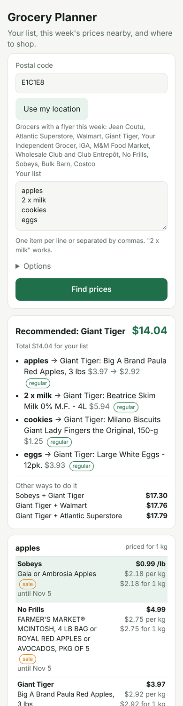

# Grocery Planner

Type a grocery list and a postal code. The app finds this week's prices at the grocers around you,
compares them fairly (by the kilogram, the litre, the dozen or the package), and tells you where to shop:
the cheapest single store, or a two-store split when the saving is worth the extra trip.

Built for the Moncton and Shediac area of New Brunswick first; it works for any Canadian postal code
that has flyers.

```
E4P 2A3 — apples, 2% milk, cookies, eggs, bread

apples    Sobeys          Gala or Ambrosia Apples              0.99 /lb  = $2.18/kg   sale
          Giant Tiger     Paula Red Apples, 3 lbs              3.97      = $2.92/kg   regular
2% milk   Giant Tiger     Beatrice Partly Skimmed 2% 4L        5.94      = $1.49/L    regular
eggs      Giant Tiger     Large White Eggs 12pk                3.93      = $0.33 each regular
          Shoppers        Grade A Large White Eggs             3.99                   sale, this weekend only
bread     Giant Tiger     Giant Value White Bread 570 g        1.97                   regular

Recommended: Giant Tiger, $13.04 for the list.
Sobeys alone: $15.72 (no 2% milk in its flyer; counted at a stand-in price).
Sobeys + Giant Tiger: $16.30 including $4.00 for the second trip.
```



## How it works

```
list + postal code
      │
      ▼
 feeders ──► offers ──► match to each list line ──► cost per typical amount ──► plan
```

* **Feeders** (`src/sources/`) each turn one source into the same `offer` shape. None of them is
  load-bearing on its own; each can be switched off with a variable in `wrangler.jsonc`.
* **Matching** (`src/engine/match.js`, `catalog.js`) maps a typed word to a catalogue entry with English
  and French synonyms, exclusions ("pommes" is not "pommes de terre", "milk" is not "chocolate milk" or
  "dog treats"), and qualifiers ("2% milk", "large eggs"). Anything not in the catalogue is matched word
  for word.
* **Prices** (`src/engine/price.js`) parses what flyers print: `/lb`, `lb $4.96/kg`, `2/5.00`, `ea.`,
  `ch.`, `+tx`, `member price`, `Online Price`, and sizes in names such as `4 LB BAG`, `251-303 G`,
  `6 × 946 ml`, `310-ml`, `18pk`. Weight and volume items are compared per kilogram or litre; eggs per
  dozen; packaged goods per package.
* **Planning** (`src/engine/decide.js`) scores every one-, two- (or three-) store combination:
  items + a trip cost per extra store + a stand-in price for items a store does not carry. An offer with
  an unknown size never beats one with a known size at the same store, and online-only prices stay out.

## Where the prices come from

| Feeder | What it gives | Permission needed | Can be cut off | Default |
|---|---|---|---|---|
| `flipp` | This week's flyer sale prices for every grocer around a postal code | None asked; it is Flipp's undocumented app backend and against their terms | Yes, at any time | on |
| `gianttiger` | Giant Tiger's regular and sale prices, from the public Shopify storefront JSON every browser loads | None; standard public endpoints | By blocking | on |
| `community` | Prices reported by this app's users, valid for two weeks | None | No | on |
| `openprices` | Open Food Facts' open price database, read and write (needs an account token and a photo as proof) | None; open data under ODbL | No | off |
| `walmart` | Walmart.ca prices parsed from its public search page | None, but the page prices a default Ontario store and the site blocks automated clients intermittently | By blocking | off |

Checked and not implemented, on purpose: Atlantic Superstore, No Frills and the other Loblaw banners,
and Sobeys, IGA, Foodland and Voilà all refuse requests that are not from a browser. Reading them would
need a browser-impersonating client or their embedded keys. That is a terms-of-use decision for the
project owner, not something to slip in. Costco's site only has online prices, not warehouse prices.

Flipp has no developer programme. Its FlyerKit API is for retailers embedding their own flyers, with
tokens issued by a Flipp contact. Treat the `flipp` feeder as an accelerator that may disappear, which is
why the other feeders exist.

## Run it

```bash
npm test                       # engine, feeders (against recorded fixtures) and API routes
node scripts/demo.mjs E1C1E8 "apples, milk, cookies" 4 2   # live, from the command line
npm install && npm run dev     # local Worker + web app at http://localhost:8787
```

Deploy to Cloudflare:

```bash
npx wrangler d1 create grocery-planner        # then put the id in wrangler.jsonc
npx wrangler kv namespace create CACHE        # same
npm run db:init                               # applies schema.sql
npm run deploy
```

Without D1 and KV the Worker keeps everything in memory, which is fine for `wrangler dev` and loses
reported prices on restart.

Variables (`wrangler.jsonc` → `vars`): `FLIPP_ENABLED`, `GIANTTIGER_ENABLED`, `WALMART_ENABLED`,
`COMMUNITY_ENABLED`, `OPENPRICES_ENABLED`, `NOMINATIM_ENABLED` (postal code from the phone's position;
needs `CONTACT_EMAIL`), `DEFAULT_TRIP_COST`, `COMMUNITY_TTL_DAYS`. Secrets: `OPENPRICES_TOKEN`.

A weekly cron (Thursday morning, when flyers change) re-runs the catalogue for every region used in the
last three weeks and stores a row per store and item in `offer_history`, so "buy now or wait" advice can
be built on real history once a few weeks have accumulated.

## API

```
GET  /api/health
GET  /api/stores?postal=E1C1E8
POST /api/plan          { postal, items: ["apples","2 x milk"], tripCost?, maxStores?, includePharmacies? }
POST /api/observe       { postal, merchant, item, price, quantity?, unit?, storeLabel?, onSale? }
GET  /api/observations?postal=E1C1E8
POST /api/locate        { lat, lon }
```

## Languages

The interface is English for now. Every string lives in `STR` in `web/app.js`, keyed by language, so
French is a matter of adding the `fr` entries and a toggle. The matching side is already bilingual
because the flyers themselves mix both.

## What is not done yet

* Store-level pricing for Walmart, and any reading of Loblaw or Sobeys sites (see above).
* Photo proof for Open Prices submissions from the web form (the API client supports it).
* "Buy now or wait" advice; the history table is being filled for it.
* French interface strings.
* Unit tests cover the engine and routes; there is no browser test of the web page yet.
